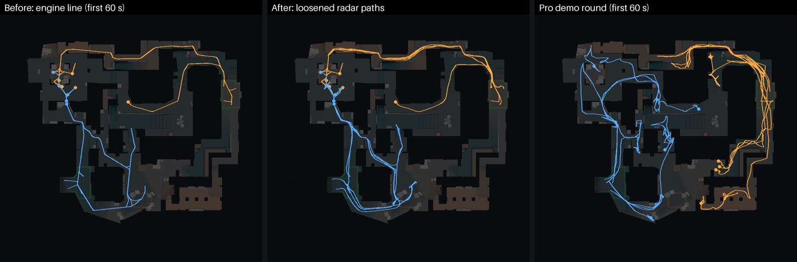

# Sight engine (2026-10)

Rounds on maps with a baked round map are now played on the map. Every
player walks the walk graph in 0.25 s ticks, on the routes and timings from
the round's plan. A fight starts when two enemies see each other, and the
existing duel maths decides it. The radar replays the engine's own positions.

The engine version stays `script-v1`: the plan, economy, buys, ratings, team
edge and manager decisions are unchanged, and the sight engine replaces only
the resolver's contact model. Maps without a round map (none in the active
pool) still use the resolver. `forceSightEngine(false)` in
`engine/match/round-sim/index.ts` brings the resolver back for comparisons.

## How a round plays

| Part | Where | What it does |
|---|---|---|
| Movement | `round-sim/sight.ts` (`opening`, `execute`, `rotate`, `planted`, …) | CTs walk to their holds; Ts walk along their routes to staging spots out of the holds' sight, then execute at the plan's time. Lurkers, fakers, mid control, AWP peeks and an aggressive CT play out on the map. |
| Sight | `sightings()` | Each tick every living enemy pair is checked: same floor, within 24 map-%, line of sight from the bake (now 24 map-% radius) and no smoke between (unless within 6 map-%). |
| Fights | `startFight`, `sidePts`, `resolveFight` | A sighting becomes a fight with the pro fight-by-distance odds (`SIGHT_ENGAGE`). The kill lands a sight-to-kill delay later (lognormal, pro median 0.43 s). Side points: holding vs walking in, aware or caught from behind, blind, busy planting or defusing, crossfire, trading, post-plant holds, pre-plant defence. `duel()` is unchanged. |
| Utility | `land()`, `executeUtility`, `entranceUtility`, `retakeUtility`, `crossSmokes` | Smokes block sight for 18 s, flashes blind who faces them, molotovs flush and block a path, HEs hurt by real distance. Ts smoke the crossings watched by CT holds on their way out. |
| Calls and saves | `call`, `rotate`, `afterDeath`, `wantsSave` | CTs rotate on information (3 Ts seen near a site, a T on it, a CT dying there). Rotators wait at the stage when the site is already lost. Saves use the resolver's `givesUp` with a sight-engine scale. |
| Bomb | `bombTick`, `defuseTick`, `planted` | The planter goes in behind the entries; a dropped bomb is fetched; Ts post up after the plant; CTs regroup, retake and defuse; Ts hear a defuse and go for it. |
| Record | `round-sim/moves.ts` | `RoundResult.moves`: each player's legs `[t×100, node, pace, walked]` and the bomb carrier changes, about 0.8 KB per round. |
| Radar | `round-script-moves.ts`, `lib/live-round-script.ts` | Rounds with `moves` are replayed exactly (live, after a resume and in the review scrubber). Rounds without them still use the event-based builder. |

## Calibration against the pro demos

`npx tsx scripts/audit-sight-engine.ts --maps 48` (stand-offs with mesh
line of sight, the pro audit's definition). Before is PR #65's resolver on
the same 48 maps (`forceSightEngine(false)`); pro is the ESTA benchmark
(1,558 demos).

| Measure | Before | Sight engine | Pro |
|---|---|---|---|
| CT round win | 52.3% | 49.4% | 53.8% |
| Kills per round | 6.91 | 6.68 | 6.53 |
| Trade kills | 24.0% | 26.3% | 16% |
| Plant rate | 49.4% | 55.4% | 52% |
| T win after a plant | 76.0% | 75.4% | 76% |
| T win without a plant | 20.2% | 19.9% | 13% |
| T wins by the bomb | 27.9% | 45.4% | 41.6% |
| First kill, median | 21.5 s | 21.7 s | 27 s |
| Plant time, median | 59.7 s | 80.2 s | 75.6 s |
| Round length, median | 70.7 s | 91.3 s | 92 s |
| Kill distance, median | (no positions) | 10.4 map-% | 12.5 map-% |
| Quiet pair-seconds per round, ≤ 4 m | – | 0.04 | 0.05 |
| Quiet pair-seconds per round, ≤ 6 map-% | – | 0.26 | 0.38 |
| Sightings ≥ 3 s per round, ≤ 6 map-% | – | 0.007 | 0.03 |
| Sightings ≥ 3 s per round, ≤ 10 map-% | – | 0.136 | 0.12 |

Kills by 10 s of the round (% of all kills):

| | 0–10 | 10–20 | 20–30 | 30–40 | 40–50 | 50–60 | 60–70 | 70–80 | 80–90 | 90–100 | 100+ |
|---|---|---|---|---|---|---|---|---|---|---|---|
| Before | 0 | 11 | 16 | 14 | 19 | 14 | 10 | 8 | 5 | 3 | 2 |
| Sight engine | 0 | 12 | 12 | 7 | 5 | 7 | 12 | 17 | 13 | 10 | 4 |
| Pro | about 10% per 10 s from 10 s to 100 s ||||||||||

The resolver's rounds were about 20 s too short and its bomb rounds too
rare. The sight engine matches pro round length, plant timing, the bomb share
and the post-plant win rate, and its stand-offs sit at the pro level.

Still off: the first kill comes about 5 s early (Ts meet CT holds on the way
to their staging spots, mostly at mid), kills are a little short-range, trades
are too common (26% vs 16%), and Ts win a few too many rounds without
planting.

The game's own calibration harness (`docs/revamp/calibration/script-v1.md`,
600 samples): **47 pass · 3 warn · 0 fail** (PR #65: 47 · 3 · 0).

## Radar movement against the pro demos

The engine walks players on the route lines and parks them on exact hold
nodes, so a straight replay looked on rails. The radar now draws each player
a little off the engine's line (`engine/match/round-script-motion.ts`):

- rounded corners, and a lane of their own while walking;
- a shuffle around the spot while holding (walk a step or two, stop, walk on);
- teammates walking on top of each other step apart.

The drift is display-only and never changes the round:

- At most 3 map-%, and only on walkable ground: a new nav-mesh raster per map,
  `data/round-maps/walk/`, baked by `scripts/bake-round-walk.ts`.
- It fades out around every kill, grenade hit, plant, defuse and bomb pick-up,
  and never pushes a player past run speed.
- It stops whenever an enemy is within 10–14 map-%, so it adds no new
  stand-offs (the quiet pair-seconds and sightings above are unchanged).

`npx tsx scripts/audit-radar-motion.ts --pro <compact demos>` compares 2 Hz
positions with 433 ESTA pro demos on the five shared maps (11,478 rounds),
using the pro benchmark extract. `--raw` shows the engine's exact line.

| Measure (per living player, 0.5 s frames) | Before | After | Pro |
|---|---|---|---|
| Standing still % | 68.9 | 43.4 | 26.1 |
| Walking % | 3.1 | 27.8 | 41.5 |
| Running % | 28.0 | 28.8 | 32.4 |
| Off the route lines, median map-% | 0.10 | 0.48 | 1.42 |
| Turn per 0.5 s while moving, median ° | 5.5 | 9.6 | 13.5 |
| Teammate within 1.5 map-% while moving % | 27.9 | 20.2 | 6.5 |
| Heatmap overlap with pro, CT · T | 0.20 · 0.28 | 0.26 · 0.36 | 1 |

What the radar can't fix on its own is where the engine sends players. Pros
spread wider (their median teammate gap is 8.9 map-%, the sim's 3.0) and use
more of the map: the heatmap overlap is about 0.3. Closing that gap means
changing the engine's routes and holds, which would change the calibrated
numbers.

## Pro positions in the sim

The sight engine now sets up where pros do. `scripts/pro-spots.ts` reads all
1,558 ESTA demos (34,585 rounds on six maps) and clusters the spots players
settle on between 8 s and the first kill: CT set-ups and T waiting spots, each
with its share of the frames (`docs/revamp/sight-engine/pro-spots/`).
`scripts/bake-pro-spots.ts` turns them into map data:

- CT set-ups become holds (`pro: true`, with their `share`). A set-up that sees
  no T way in to its site is left out (the sight engine would never play it).
  Each gets a short `spur` route to the route lines over walkable ground.
- T waiting spots become `stages`. Stagers, lurkers and fakers spread over the
  free ones near their route, out of known CT angles, instead of queueing on
  one line. With none free, they stop a node short of a mate.
- CTs pick holds weighted by pro share (geometry-only holds count 1%). The
  known pro angles also decide which crossings Ts smoke on the way out.
- The older radar builder keeps the geometry holds only.

Re-run: `npx tsx scripts/pro-spots.ts <compact demos> --out <dir>`, copy to
`docs/revamp/sight-engine/pro-spots/`, then `npx tsx scripts/bake-pro-spots.ts
docs/revamp/sight-engine/pro-spots && npx tsx scripts/bake-round-visibility.ts`.
Anubis and Sandstone have no pro demos and keep their geometry holds.

The pro holds made CTs play more passive spots and pushed the plant rate to
62–66%, so the retune raised `SIGHT_CT_DEFEND` 4 → 9 and `SIGHT_POST` 16 → 30.
Sight audit, 48 maps with mesh line of sight:

| Measure | Before pro spots | With pro spots | Pro |
|---|---|---|---|
| CT round win | 49.4% | 52.6% | 53.8% |
| Kills per round | 6.68 | 6.56 | 6.53 |
| Trade kills | 26.3% | 24.4% | 16% |
| Plant rate | 55.4% | 57.4% | 52% |
| T win after a plant | 75.4% | 75.9% | 76% |
| T win without a plant | 19.9% | 9.1% | 13% |
| T wins by the bomb | 45.4% | 50.8% | 41.6% |
| First kill, median | 21.7 s | 21.8 s | 27 s |
| Plant time, median | 80.2 s | 80.7 s | 75.6 s |
| Round length, median | 91.3 s | 94.5 s | 92 s |
| Kill distance, median | 10.4 map-% | 9.6 map-% | 12.5 map-% |
| Sightings ≥ 3 s per round, ≤ 10 map-% | 0.136 | 0.065 | 0.12 |

Radar movement (190 demos, 5,018 pro rounds; off-route now counts the spurs, so
it is not comparable with the table above):

| Measure | Before pro spots | With pro spots | Pro |
|---|---|---|---|
| Standing still % | 43.4 | 47.2 | 26.2 |
| Walking % | 27.8 | 24.2 | 41.7 |
| Teammate within 1.5 map-% while moving % | 20.2 | 18.1 | 6.5 |
| Heatmap overlap with pro, CT | 0.26 | 0.39–0.45 | 1 |
| Heatmap overlap with pro, T | 0.36 | 0.35–0.42 | 1 |

Calibration harness, 600 samples: **44 pass · 6 warn · 0 fail**. The new warns
are kills per round 6.58 and KPR 0.66 (just under the harness's older 6.6 and
0.66 bounds; the ESTA pros play 6.53), aces 0.39 per map (bound 0.3) and CT
wins on time 13.9% of CT wins (bound 13%).

## Tuning

All sight-engine knobs are the `SIGHT_*` block in
`engine/match/round-sim/tuning.ts`. The main calibration levers:

- `SIGHT_EXEC`: execute times by T strategy (plant timing, round length).
- `SIGHT_CT_BIAS` (3) and `SIGHT_CT_DEFEND` (9, before the plant only):
  side balance.
- `SIGHT_POST` (30): posted Ts against retakers. `SIGHT_SAVE_RETAKE` (3):
  CT saves on a plant (bomb share).
- `SIGHT_SKILL` (0.75) and `SIGHT_STAR` (0.25): every fight is a real duel
  here, so raw skill is flattened a little and standouts get their swing
  (skill curve, star impact).
- `SIGHT_TRADE` (2): trade points.
- `SIGHT_STAGE_SPREAD` (12): how far a T walks off the route to a pro waiting
  spot. `SIGHT_KNOWN_ANGLE` (0.03): the smallest pro share that makes a CT
  angle one every T knows (Ts stage out of it and smoke it off).

## Other changes

- Line-of-sight bake radius 12 → 24 map-% (`BAKE_RADIUS`); all 8 maps
  re-baked. `sees()` keeps its 12 map-% cap, `seesFar()` reaches 24.
- Integrity rule: a T win by explosion with every T dead is allowed (the bomb
  still goes off when no CT can reach it in time).
- script-v1 KILL events always carry `chip` (0 = no return fire), so the HP
  view knows the round has per-hit data.
- `scripts/map-world.ts`: the mesh raycaster shared by the bake and the audit.
